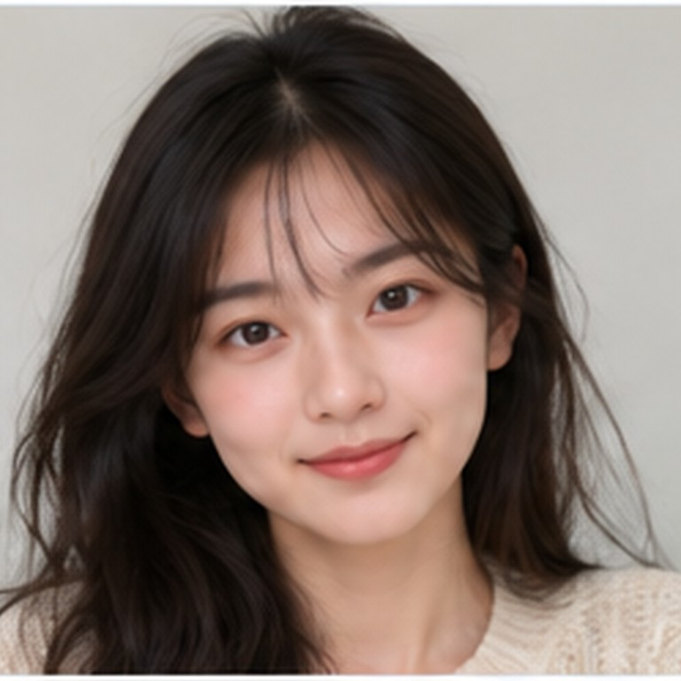
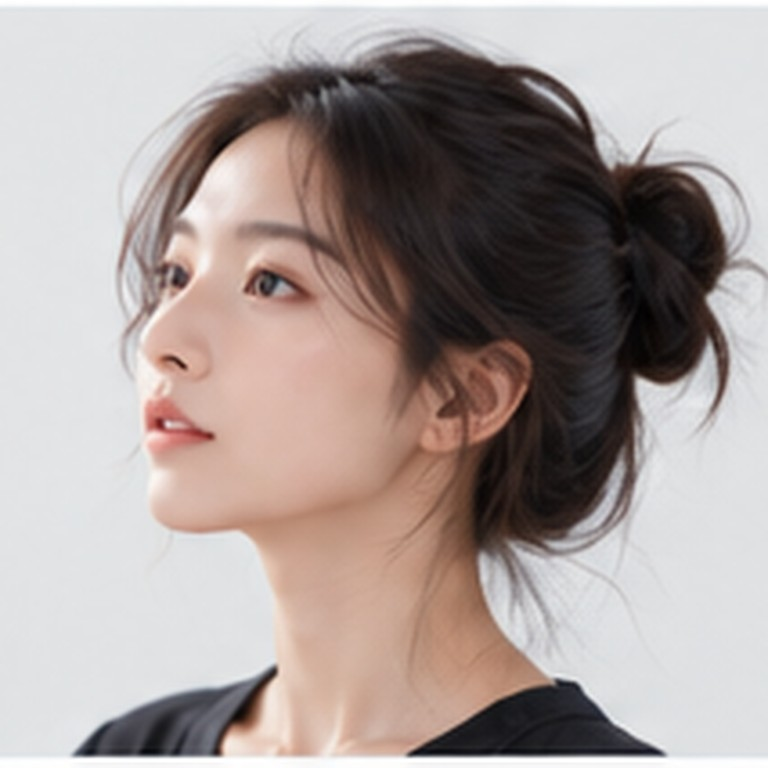
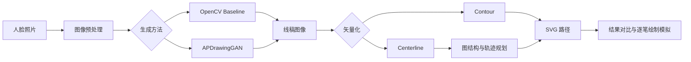

# RobotPortraitArt

**从人脸照片生成艺术肖像，再转换为有序的 SVG 机器人绘制轨迹。**

RobotPortraitArt 是一个基于 Python、FastAPI 和 Vue 3 的肖像生成与绘制路径可视化项目。它提供三种肖像生成方法（OpenCV Baseline / APDrawingGAN / GANs N’ Roses 卡通）、两种矢量化方法（Contour / Centerline），并将路径规划结果用于浏览器中的真实 SVG 逐笔模拟。

> **运行范围：** 当前实现的是图像生成、二维像素空间中的路径规划，以及绘制轨迹的**软件模拟**。仓库不包含实体机械臂驱动、关节运动学或硬件闭环控制。

## 团队成员首次安装（Windows，先看这里）

> **自动安装器已经合并到默认 `main` 分支。** 新组员直接克隆仓库即可获取 `install.ps1`。首次部署仍需进行实际验收。

打开 **Windows PowerShell**，直接运行：

```powershell
git clone --branch anime-addition https://github.com/Saac-Alexcod/RobotPortraitArt.git
cd RobotPortraitArt
powershell.exe -NoProfile -ExecutionPolicy Bypass -File .\install.ps1
```

安装器将尽可能**检测并复用**已有 Windows Python、Node、WSL2 和 GAN 环境；缺少部分软件和官方模型时尝试下载安装，然后分别运行 **APDrawingGAN 和 GANs N’ Roses → SVG** 真实推理验收，并启动 FastAPI 与 Vue。

安装后**手动打开** `http://127.0.0.1:5173`，选内置正面示例并试用 APDrawingGAN + Centerline。需要 `Git` 先安装才能克隆；本机 GAN 还需要支持 WSL CUDA 的 NVIDIA GPU、可用驱动及授权访问下载源。**`wsl.exe` 完全缺失时当前脚本不能自动启用 Windows WSL 组件，需要按系统提示人工启用/重启。** 无 GPU 可尝试 `-BaselineOnly`，但它不是 GAN 已成功安装的标志。

**给组员的操作说明：** [一页快速上手](docs/TEAMMATE_QUICKSTART.md) · [自动安装全过程](docs/AUTOMATIC_INSTALL.md) · [首次安装与模型](docs/FIRST_RUN_SETUP.md) · [故障、错误码和日志](docs/INSTALL_TROUBLESHOOTING.md)。遇到失败先看提示和 `outputs/installer_logs/`，**不要直接删除现有 Python、Ubuntu 和模型**。如需 Windows 重启或首次 Ubuntu 初始化，完成后重新运行同一安装命令。

> **发布状态：候选安装器。** 维护者本机已完成真实 GAN 出图及前后端启动验证，但组员的全新 Windows 环境还未得到充分实机验收；不能承诺所有硬件、网络和权限条件下 100% 成功。

## 功能概览

- **人脸预处理：** YuNet 五点检测、相似变换对齐和 PPHumanSeg 人像分割（APDrawingGAN 自动模式）。
- **艺术肖像生成：** OpenCV Baseline 可作为轻量对照；APDrawingGAN 使用独立的 WSL/PyTorch CUDA 环境。
- **卡通风格：** GANs N’ Roses 在同一 WSL/CUDA 环境推理，Windows 继续启动主程序；首次运行 `.\scripts\start_web.ps1 -SetupCartoon`。配置、模型限制与评分方法见 [卡通接入与课程验收](docs/CARTOON_SETUP.md)，实测见 [验收记录](docs/COURSE_VALIDATION.md)。
- **轨迹生成：** Contour 或 Centerline 矢量化；中心线模式包含骨架图处理、Minimum-Lift Trail Cover、Greedy 和 2-opt 抬笔路径优化。
- **可交互 Web 界面：** 上传人像、提交并查看任务状态、查看各阶段图片、A/B 对比、SVG 逐笔播放及结果下载。
- **实验评估：** 提供 SSIM、Edge-F1、可选 LPIPS、批量评估与可复现的矢量化对比脚本。

## 示例输入

仓库内置 **4 张轻量级 AI 合成人像**，无需下载 CelebA 或寻找真人照片即可试用。建议先选择正面样例；侧脸图主要用于观察算法边界。

| 基础正面 | 长发细节 | 眼镜细节 | 侧脸挑战 |
|:--:|:--:|:--:|:--:|
|  |  |  |  |
| `portrait_sample.jpg` | `portrait_long_hair.jpg` | `portrait_glasses.jpg` | `portrait_profile_challenge.jpg` |
| 推荐首次体验 | 观察发丝线条 | 观察眼镜轮廓 | 自动人脸检测可能失败 |

以下为**第一张图片在本项目中实际运行 OpenCV Baseline + Centerline 得到的结果**，不是 APDrawingGAN 输出，也不是模拟绘制的美化图片：

| 示例输入 | OpenCV Baseline | Centerline 轨迹预览 |
|:--:|:--:|:--:|
|  |  |  |

- [样例说明及适用范围](data/examples/README.md)；所有样例均为合成人像，非 CelebA 图片。
- Web 工作台可直接点击四张示例缩略图载入图片（无需在文件管理器中寻找）；命令行则使用 `--input data/examples/文件名`。
- **侧脸挑战样例不保证 YuNet 对齐或 GAN 推理成功**；这不是人脸检测成功率的基准测试。
- `data/input/demo_face.png` 是简笔画图形测试图，不作为自动人脸检测的标准样例。

## 运行流程



## 开发者手动启动（可选，首次使用请优先用上方安装器）

手动部署建议使用经过验证的 **Python 3.10–3.12**、Node.js（满足 [`frontend/package.json`](frontend/package.json) 的 Vite 版本要求）、npm 和 PowerShell。APDrawingGAN 另外需要 WSL2、独立 Python/PyTorch 环境及可用的模型权重；**Baseline 不需要 CUDA 或 APDrawingGAN 权重**。

### 1. 获取代码和安装后端依赖

```powershell
git clone https://github.com/Saac-Alexcod/RobotPortraitArt.git
cd RobotPortraitArt
python -m venv .venv
.\.venv\Scripts\Activate.ps1
python -m pip install -r requirements-web.txt
```

也可以跳过手动创建 `.venv` 和安装依赖：安装好 Windows Python 3.10+ 后直接运行启动脚本，它会在首次启动时创建项目 `.venv` 并安装缺少的后端依赖。下载失败时会停止并显示错误，修复网络后重试即可。

### 2. 启动 API

```powershell
.\scripts\start_web.ps1
```

优先使用 `http://127.0.0.1:8000`；端口被占用时自动尝试 8001、8002 等（最多 100 个端口），不会结束已有进程。以终端打印的 `API` 地址为准，接口文档为该地址加 `/docs`。

```powershell
# 仅检查环境和端口，不安装依赖、不启动服务
.\scripts\start_web.ps1 -CheckOnly
# 首次准备 APDrawingGAN 的 WSL Python/CUDA 依赖，成功后启动后端
.\scripts\start_web.ps1 -SetupAPD
```

`-SetupAPD` 需要已安装 WSL Ubuntu 和支持 CUDA 的 NVIDIA 驱动，会下载较大的 PyTorch 包；具体前提、代理问题与模型准备见 [配置说明](docs/MODEL_SETUP.md)。普通启动不自动下载 GAN 依赖。

> 该脚本会尝试检查 WSL 中的 APDrawingGAN；如果 WSL/CUDA 不可用，它会给出警告并继续启动 **Baseline**。这不是完整 GAN 环境已配置成功的标志。首次使用可访问 `GET /api/methods` 查看实际可用方法。

### 3. 启动前端（另开一个终端）

```powershell
cd frontend
npm ci
npm run dev
```

访问：**http://127.0.0.1:5173**（若前端端口被占用，以 Vite 输出为准）。Vite 从 `.cache/web-runtime.json` 自动读取后端地址，后端换端口后无需修改前端配置或重启 Vite。多个后端同时运行时，前端连接最后启动的实例。在上传区点击「试用示例人像」里的任一缩略图（首次推荐短发正面），先用 **OpenCV Baseline + Centerline** 验证完整上传、生成、下载流程；完成模型准备后再切换 APDrawingGAN。

### 4. 命令行最小示例（无需 GAN 权重）

从仓库根目录、在虚拟环境中执行：

```powershell
python scripts/run_pipeline.py `
  --input data/examples/portrait_sample.jpg `
  --output-dir outputs/sample_baseline `
  --method baseline `
  --config configs/centerline.yaml `
  --size 512
```

结果写入 `outputs/sample_baseline/`。`outputs/` 属于本地产物，不提交到 Git。

## 卡通模型使用注意事项

当前已接入 **GANs N’ Roses**，前端显示为「GANs N’ Roses · 卡通」。Windows 运行 FastAPI、Vue 和矢量化流程，WSL2 内的 PyTorch/CUDA 运行模型；无需把整个项目迁入 Linux。

```powershell
# 已有可用 WSL PyTorch/CUDA 环境：下载卡通模型并启动后端
.\scripts\start_web.ps1 -SetupCartoon
# 新机器：先准备 WSL Ubuntu 和 NVIDIA 驱动，再同时初始化环境与模型
.\scripts\start_web.ps1 -SetupAPD -SetupCartoon
# 安装后正常启动
.\scripts\start_web.ps1
```

- **首次安装需要联网：** `-SetupCartoon` 从 Windows 下载固定版本源码及约 302 MiB 官方权重到 `third_party/GANsNRoses/`，校验 checkpoint SHA256 并保留来源记录。普通启动和 `-CheckOnly` 不会自动下载模型；模型、环境、PPT 工作目录及运行产物不随 Git 分支分发。
- **环境与尺寸：** 复用 APDrawingGAN 的 WSL Python 自动发现逻辑，支持 `-Distro`、`-APDPython` 覆盖，无需改用户名。卡通模型固定 256×256，APDrawingGAN 固定 512×512；前端选择风格后自动设置尺寸。`-SetupCartoon` 不能与 `-CheckOnly` 同用。
- **画风与身份保留：** GANs N’ Roses 的预训练数据主要为女性自拍。男性、眼镜、侧脸可能出现性别外观、发型、五官变化；模型可用不等于原人物身份保留达标。参见 [上游模型说明](https://github.com/mchong6/GANsNRoses)。
- **矢量输出：** 保留彩色卡通 PNG，同时提取黑白轮廓生成 SVG；单笔绘制不保留彩色填充。建议用 Centerline 检查细节及抬笔路径，逐笔显示属于软件模拟。
- **评分边界：** 「技术数据」提供原图→风格图、原图→矢量图的 SSIM / Edge-F1，以及线条→SVG 的保留程度。这些指标不是艺术逼真度、身份认证或课程总分；正式评分仍需人工评价，不能把四张示例的结果外推到全部人像。
- **第二个卡通模型状态：** 已确定按课题要求采用 **U-GAT-IT**，但当前分支尚未接入其推理代码和权重，也没有该模型的实测评分。其 [官方 PyTorch 仓库](https://github.com/znxlwm/UGATIT-pytorch) 与 [官方 TensorFlow 权重](https://github.com/taki0112/UGATIT#pretrained-model) 属于不同框架；TensorFlow checkpoint 不能直接用 `torch.load` 加载。后续需要独立适配并验证，不能将现有 `-SetupCartoon` 误认为 U-GAT-IT 安装命令。

完整说明见 [卡通接入与课程验收](docs/CARTOON_SETUP.md)，已完成模型的实际结果见 [验收记录](docs/COURSE_VALIDATION.md)。本机 `outputs/course_evaluation/` 中的 HTML、CSV、PNG 和 SVG 不提交 Git；其他机器可运行 `python scripts/evaluate_course.py` 重新生成。

## 启用 APDrawingGAN

**Git 仓库不附带 GAN checkpoint、YuNet / PPHumanSeg ONNX 模型及整个 CelebA 数据集。** 这是为了避免模型文件过大、数据再分发和第三方授权问题。

需要另外准备：

| 文件或环境 | 本项目期望的位置／说明 |
|---|---|
| APDrawingGAN 源码 | `third_party/APDrawingGAN/`（仓库已有第三方源码） |
| APDrawingGAN checkpoint | `third_party/APDrawingGAN/checkpoints/formal_author/300_net_gen.pt`（或适配器支持的对应官方权重布局） |
| YuNet ONNX | `third_party/models/face_detection_yunet_2023mar.onnx` |
| PPHumanSeg ONNX | `third_party/models/human_segmentation_pphumanseg_2023mar.onnx` |
| 推理环境 | WSL2 内的 Python / PyTorch CUDA，启动脚本自动选择已安装的 Ubuntu，也可用 `-Distro` 指定 |

官方资源链接、配置与检查命令见 **[模型与环境配置说明](docs/MODEL_SETUP.md)**。使用他人的模型权重前请遵守上游许可证与发布条件。

可用性检查：

```powershell
python scripts/check_apdrawinggan.py --python /path/to/wsl/python
python scripts/run_pipeline.py --list-methods --apd-python /path/to/wsl/python
```

路径示例应替换为**你自己的 WSL Python 可执行文件**，不需要使用作者计算机的用户名或磁盘路径。

`start_web.ps1` 优先采用 `-APDPython` 参数，其次读取 `ROBOT_PORTRAIT_APD_PYTHON` 环境变量；两者都未配置时，扫描 WSL 当前用户的 `~/.venvs/robotportrait-apd`、常见 venv/Conda 环境及系统 Python，选择依赖与 CUDA 检查通过的解释器。发行版优先采用 `-Distro` 或 `ROBOT_PORTRAIT_APD_DISTRO`，否则依次选择已安装的 Ubuntu-22.04、Ubuntu-24.04、Ubuntu 或其他非 Docker 发行版。无需修改脚本中的用户名或路径。例如：

```powershell
.\scripts\start_web.ps1
# 已有独立的 WSL 环境时，传入该环境的 Linux 绝对路径：
.\scripts\start_web.ps1 -APDPython /home/you/.venvs/robotportrait-apd/bin/python
```

Windows 的 `.venv\Scripts\python.exe` 用于 FastAPI，APDrawingGAN 依赖安装到 **WSL Python** 中。没有可用 GAN 环境时，普通启动继续提供 Baseline；`-RequireAPDrawingGAN` 则要求环境、checkpoint 和自动预处理模型均通过检查，否则停止。显式传入的解释器无效时会报告错误，不会悄悄换成其他环境。

## API 与输出

| 接口 | 用途 |
|---|---|
| `GET /api/health` | 后端存活检查 |
| `GET /api/methods` | 生成方法及环境可用性 |
| `POST /api/jobs` | 上传图片并创建处理任务 |
| `GET /api/jobs/{job_id}` | 查询任务状态 |
| `GET /api/jobs/{job_id}/manifest` | 获取本次任务的指标与文件清单 |
| `GET /api/jobs/{job_id}/files/{filename}` | 下载允许访问的输出文件 |

成功任务通常包括预处理图片、艺术肖像 PNG、机器人 SVG、矢量预览和 Manifest JSON；APDrawingGAN 自动模式还可能提供模型实际使用的对齐输入。实际文件以 Manifest 为准。

> **指标解释：** `Pen-down` 是笔尖落笔后的图像路径长度，`Pen-up` 是笔尖抬起移动的图像路径长度；2-opt 优化率表示相对于初始排序的空程改善，**不等于画质提升或实体机器人运行时间节约率**。

## 测试与项目结构

```powershell
python -m pytest -q
cd frontend
npm run typecheck
npm run build
```

主要目录：

```text
frontend/                 Vue 3 / TypeScript 交互界面
src/robot_portrait/       Python Pipeline、算法与 FastAPI
src/robot_portrait/web/   API、任务存储与 Worker
configs/                  Contour / Centerline 配置
scripts/                  启动、测试、评估工具
tests/                    自动测试
data/examples/             可公开分发的示例输入
data/input/                本地个人输入（默认忽略）
data/CelebA/               可选外部数据集（不分发）
third_party/              APDrawingGAN 源码与本地模型目录
outputs/                  本地结果文件（默认忽略）
```

### 文档导航及版本说明

- **[正式技术与实验报告](docs/FINAL_REPORT.md)**：截至 2026-10-19 的 Core 20 张、40 次历史 Benchmark；含统计口径、失败案例、评价边界及汇总图表。**并非**本页四张合成示例的测试结果。
- **[阶段性固定栅格实验](EXPERIMENTS.md)**：E0–E5 路径规划过程日志，包含单图消融结果；历史测试数不要当成当前版本测试总数。
- **[版本、证据及答辩引用指南](docs/DOCUMENTATION_STATUS.md)**：区分 `v1.0.1` 软件版本与旧实验提交，说明未公开的原始数据和可以准确引用的数字。
- **[历史交接记录](docs/FINAL_HANDOFF_20261024.md)**：开发时点的答辩准备快照，不用作最新运行手册。
- **[近期历史与请求耗时](docs/RECENT_HISTORY_AND_LATENCY.md)**：浏览器本地历史和短期预检缓存的功能边界。

> 报告中的成功率、运行时间与结构 F1 都来自特定历史实验环境。要确认当前电脑上的最新性能，请亲自运行并记录环境，不要直接将旧实验均值描述为 `v1.0.1` 的新测结果。

## 已知限制

- Git 仓库**不包含**模型权重或预装环境；功能分支中的 `install.ps1` 会尝试自动准备所需组件，但遇到缺失 WSL 系统组件、权限、驱动或第三方网络限制时可能仍需人工处理。
- Centerline 对大面积黑色填充、交叉线及背景纹理可能产生较多分支和碎线。
- 生成轨迹属于二维像素空间中的 SVG 绘制顺序，不包含实体机械臂所需的物理标定、动力学与运动控制。
- 推理速度、结果质量和部分 GPU 运算的确定性受环境及输入图像影响。
- 本仓库不是 CelebA 的镜像；大型训练/评估数据应从原始提供方获取并遵守其使用限制。

## 致谢、第三方依赖与许可

本项目集成／参考了 [APDrawingGAN](https://github.com/yiranran/APDrawingGAN) 与 [OpenCV Zoo](https://github.com/opencv/opencv_zoo) 的相关模型和方法。第三方组件适用**各自**的许可证和使用条款，请参见相应上游仓库以及 `third_party/APDrawingGAN/LICENSE`。

参考工程包括 APDrawingGAN、APDrawingGAN++、U-GAT-IT、GANs N' Roses 与 CelebA。使用时请遵守各自许可证和数据协议。

**项目根目录目前尚未提供独立的 `LICENSE` 文件。** 因此请勿将本仓库自动理解为采用 MIT、Apache-2.0 或其他开源许可证；代码的再利用和再分发条件需要项目维护者进一步明确。示例人像为合成数据，使用说明见 [`data/examples/README.md`](data/examples/README.md)。

> 首次安装出现下载卡住、代理/WSL/CUDA 错误时，参阅 [首次安装排障与日志指南](docs/INSTALL_TROUBLESHOOTING.md)。默认模式的完成门槛是实际 GAN 推理与服务检查；浏览器交互仍须人工测试。
