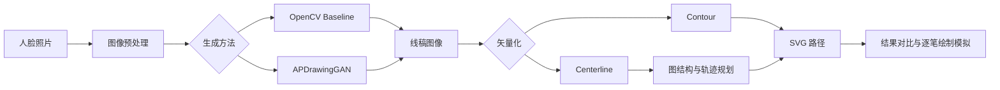

# RobotPortraitArt

**从人脸照片生成艺术肖像，再转换为有序的 SVG 机器人绘制轨迹。**

RobotPortraitArt 是一个基于 Python、FastAPI 和 Vue 3 的肖像生成与绘制路径可视化项目。它提供两种肖像生成方法（OpenCV Baseline / APDrawingGAN）、两种矢量化方法（Contour / Centerline），并将路径规划结果用于浏览器中的真实 SVG 逐笔模拟。

> **运行范围：** 当前实现的是图像生成、二维像素空间中的路径规划，以及绘制轨迹的**软件模拟**。仓库不包含实体机械臂驱动、关节运动学或硬件闭环控制。

## New computer setup (Windows / WSL2)

**新电脑从 GitHub 克隆的源码不包含 Python 虚拟环境、预训练模型或 WSL CUDA。** 现在提供一个**候选版首次安装入口**，按照“安装缺失项 → 实际 GAN 推理验收 → 启动双端服务”执行。首次部署可能需要管理员授权、Windows 重启或网络代理配置；如被系统中断，重新运行同一个命令即可。

```powershell
powershell.exe -NoProfile -ExecutionPolicy Bypass -File .\install.ps1
```

详细介绍、支持条件、失败恢复与新电脑验收流程参见 [Automatic install guide](docs/AUTOMATIC_INSTALL.md)。**这是待组员 Windows 新电脑实测的候选安装程序，不保证任意硬件和网络环境 100% 成功。** 安装过程只有真实 APDrawingGAN 推理、SVG 和图像输出完成才能判为成功；离线检查或 Baseline 能运行不能替代这项验收。

仅诊断：`powershell.exe -NoProfile -ExecutionPolicy Bypass -File .\install.ps1 -Doctor`。只装 Windows/前端与 Baseline：加 `-BaselineOnly`。针对模型的独立下载工具和说明仍见 [First-run setup](docs/FIRST_RUN_SETUP.md)。

## 功能概览

- **人脸预处理：** YuNet 五点检测、相似变换对齐和 PPHumanSeg 人像分割（APDrawingGAN 自动模式）。
- **艺术肖像生成：** OpenCV Baseline 可作为轻量对照；APDrawingGAN 使用独立的 WSL/PyTorch CUDA 环境。
- **轨迹生成：** Contour 或 Centerline 矢量化；中心线模式包含骨架图处理、Minimum-Lift Trail Cover、Greedy 和 2-opt 抬笔路径优化。
- **可交互 Web 界面：** 上传人像、提交并查看任务状态、查看各阶段图片、A/B 对比、SVG 逐笔播放及结果下载。
- **实验评估：** 提供 SSIM、Edge-F1、可选 LPIPS、批量评估与可复现的矢量化对比脚本。

## 示例输入

仓库内置 **4 张轻量级 AI 合成人像**，无需下载 CelebA 或寻找真人照片即可试用。建议先选择正面样例；侧脸图主要用于观察算法边界。

| 基础正面 | 长发细节 | 眼镜细节 | 侧脸挑战 |
|:--:|:--:|:--:|:--:|
|  |  |  |  |
| `portrait_sample.jpg` | `portrait_long_hair.jpg` | `portrait_glasses.jpg` | `portrait_profile_challenge.jpg` |
| 推荐首次体验 | 观察发丝线条 | 观察眼镜轮廓 | 自动人脸检测可能失败 |

以下为**第一张图片在本项目中实际运行 OpenCV Baseline + Centerline 得到的结果**，不是 APDrawingGAN 输出，也不是模拟绘制的美化图片：

| 示例输入 | OpenCV Baseline | Centerline 轨迹预览 |
|:--:|:--:|:--:|
|  |  |  |

- [样例说明及适用范围](data/examples/README.md)；所有样例均为合成人像，非 CelebA 图片。
- Web 工作台可直接点击四张示例缩略图载入图片（无需在文件管理器中寻找）；命令行则使用 `--input data/examples/文件名`。
- **侧脸挑战样例不保证 YuNet 对齐或 GAN 推理成功**；这不是人脸检测成功率的基准测试。
- `data/input/demo_face.png` 是简笔画图形测试图，不作为自动人脸检测的标准样例。

## 运行流程



## 快速开始（Windows + PowerShell）

建议使用 **Python 3.10+**、Node.js（满足 [`frontend/package.json`](frontend/package.json) 的 Vite 版本要求）、npm 和 PowerShell。APDrawingGAN 另外需要 WSL2、独立 Python/PyTorch 环境及可用的模型权重；**Baseline 不需要 CUDA 或 APDrawingGAN 权重**。

### 1. 获取代码和安装后端依赖

```powershell
git clone https://github.com/Saac-Alexcod/RobotPortraitArt.git
cd RobotPortraitArt
python -m venv .venv
.\.venv\Scripts\Activate.ps1
python -m pip install -r requirements-web.txt
```

### 2. 启动 API

```powershell
.\scripts\start_web.ps1
```

默认地址：`http://127.0.0.1:8000`，接口文档：`http://127.0.0.1:8000/docs`。

> 该脚本会尝试检查 WSL 中的 APDrawingGAN；如果 WSL/CUDA 不可用，它会给出警告并继续启动 **Baseline**。这不是完整 GAN 环境已配置成功的标志。首次使用可访问 `GET /api/methods` 查看实际可用方法。

### 3. 启动前端（另开一个终端）

```powershell
cd frontend
npm ci
npm run dev
```

访问：**http://127.0.0.1:5173**。Vite 会将 `/api` 请求代理到本地后端。在上传区点击「试用示例人像」里的任一缩略图（首次推荐短发正面），先用 **OpenCV Baseline + Centerline** 验证完整上传、生成、下载流程；完成模型准备后再切换 APDrawingGAN。

### 4. 命令行最小示例（无需 GAN 权重）

从仓库根目录、在虚拟环境中执行：

```powershell
python scripts/run_pipeline.py `
  --input data/examples/portrait_sample.jpg `
  --output-dir outputs/sample_baseline `
  --method baseline `
  --config configs/centerline.yaml `
  --size 512
```

结果写入 `outputs/sample_baseline/`。`outputs/` 属于本地产物，不提交到 Git。

## 启用 APDrawingGAN

**Git 仓库不附带 GAN checkpoint、YuNet / PPHumanSeg ONNX 模型及整个 CelebA 数据集。** 这是为了避免模型文件过大、数据再分发和第三方授权问题。

需要另外准备：

| 文件或环境 | 本项目期望的位置／说明 |
|---|---|
| APDrawingGAN 源码 | `third_party/APDrawingGAN/`（仓库已有第三方源码） |
| APDrawingGAN checkpoint | `third_party/APDrawingGAN/checkpoints/formal_author/300_net_gen.pt`（或适配器支持的对应官方权重布局） |
| YuNet ONNX | `third_party/models/face_detection_yunet_2023mar.onnx` |
| PPHumanSeg ONNX | `third_party/models/human_segmentation_pphumanseg_2023mar.onnx` |
| 推理环境 | WSL2 内的 Python / PyTorch CUDA，默认发行版 `Ubuntu-22.04` |

官方资源链接、配置与检查命令见 **[模型与环境配置说明](docs/MODEL_SETUP.md)**。使用他人的模型权重前请遵守上游许可证与发布条件。

可用性检查：

```powershell
python scripts/check_apdrawinggan.py --python /path/to/wsl/python
python scripts/run_pipeline.py --list-methods --apd-python /path/to/wsl/python
```

路径示例应替换为**你自己的 WSL Python 可执行文件**，不需要使用作者计算机的用户名或磁盘路径。

## API 与输出

| 接口 | 用途 |
|---|---|
| `GET /api/health` | 后端存活检查 |
| `GET /api/methods` | 生成方法及环境可用性 |
| `POST /api/jobs` | 上传图片并创建处理任务 |
| `GET /api/jobs/{job_id}` | 查询任务状态 |
| `GET /api/jobs/{job_id}/manifest` | 获取本次任务的指标与文件清单 |
| `GET /api/jobs/{job_id}/files/{filename}` | 下载允许访问的输出文件 |

成功任务通常包括预处理图片、艺术肖像 PNG、机器人 SVG、矢量预览和 Manifest JSON；APDrawingGAN 自动模式还可能提供模型实际使用的对齐输入。实际文件以 Manifest 为准。

> **指标解释：** `Pen-down` 是笔尖落笔后的图像路径长度，`Pen-up` 是笔尖抬起移动的图像路径长度；2-opt 优化率表示相对于初始排序的空程改善，**不等于画质提升或实体机器人运行时间节约率**。

## 测试与项目结构

```powershell
python -m pytest -q
cd frontend
npm run typecheck
npm run build
```

主要目录：

```text
frontend/                 Vue 3 / TypeScript 交互界面
src/robot_portrait/       Python Pipeline、算法与 FastAPI
src/robot_portrait/web/   API、任务存储与 Worker
configs/                  Contour / Centerline 配置
scripts/                  启动、测试、评估工具
tests/                    自动测试
data/examples/             可公开分发的示例输入
data/input/                本地个人输入（默认忽略）
data/CelebA/               可选外部数据集（不分发）
third_party/              APDrawingGAN 源码与本地模型目录
outputs/                  本地结果文件（默认忽略）
```

### 文档导航及版本说明

- **[正式技术与实验报告](docs/FINAL_REPORT.md)**：截至 2026-10-19 的 Core 20 张、40 次历史 Benchmark；含统计口径、失败案例、评价边界及汇总图表。**并非**本页四张合成示例的测试结果。
- **[阶段性固定栅格实验](EXPERIMENTS.md)**：E0–E5 路径规划过程日志，包含单图消融结果；历史测试数不要当成当前版本测试总数。
- **[版本、证据及答辩引用指南](docs/DOCUMENTATION_STATUS.md)**：区分 `v1.0.1` 软件版本与旧实验提交，说明未公开的原始数据和可以准确引用的数字。
- **[历史交接记录](docs/FINAL_HANDOFF_20261024.md)**：开发时点的答辩准备快照，不用作最新运行手册。
- **[近期历史与请求耗时](docs/RECENT_HISTORY_AND_LATENCY.md)**：浏览器本地历史和短期预检缓存的功能边界。

> 报告中的成功率、运行时间与结构 F1 都来自特定历史实验环境。要确认当前电脑上的最新性能，请亲自运行并记录环境，不要直接将旧实验均值描述为 `v1.0.1` 的新测结果。

## 已知限制

- APDrawingGAN 模型环境和 checkpoint 需要使用者自行配置；克隆仓库不能自动获得完整 GAN 推理能力。
- Centerline 对大面积黑色填充、交叉线及背景纹理可能产生较多分支和碎线。
- 生成轨迹属于二维像素空间中的 SVG 绘制顺序，不包含实体机械臂所需的物理标定、动力学与运动控制。
- 推理速度、结果质量和部分 GPU 运算的确定性受环境及输入图像影响。
- 本仓库不是 CelebA 的镜像；大型训练/评估数据应从原始提供方获取并遵守其使用限制。

## 致谢、第三方依赖与许可

本项目集成／参考了 [APDrawingGAN](https://github.com/yiranran/APDrawingGAN) 与 [OpenCV Zoo](https://github.com/opencv/opencv_zoo) 的相关模型和方法。第三方组件适用**各自**的许可证和使用条款，请参见相应上游仓库以及 `third_party/APDrawingGAN/LICENSE`。

**项目根目录目前尚未提供独立的 `LICENSE` 文件。** 因此请勿将本仓库自动理解为采用 MIT、Apache-2.0 或其他开源许可证；代码的再利用和再分发条件需要项目维护者进一步明确。示例人像为合成数据，使用说明见 [`data/examples/README.md`](data/examples/README.md)。

> 首次安装出现下载卡住、代理/WSL/CUDA 错误时，参阅 [首次安装排障与日志指南](docs/INSTALL_TROUBLESHOOTING.md)。安装器只有在真实 GAN 推理与服务检查通过后才报告成功。


### First-run compatibility checks (deployment candidate)

The optional Windows `install.ps1` now probes installed Python and WSL2 distributions before setup, prefers a compatible existing Ubuntu environment (including Ubuntu 24.04), and keeps the PyTorch 2.5.1 Python version constraints explicit. It uses a project-local Node distribution when the installed Node is incompatible. See [automatic setup](docs/AUTOMATIC_INSTALL.md) and [troubleshooting](docs/INSTALL_TROUBLESHOOTING.md). The installer remains an **unverified candidate for clean Windows machines** until a teammate completes a fresh installation and actual GAN inference.
