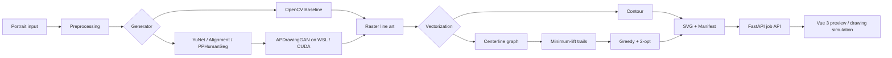
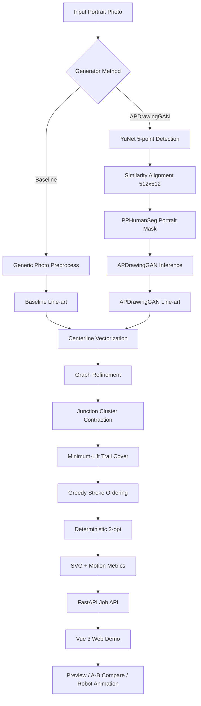
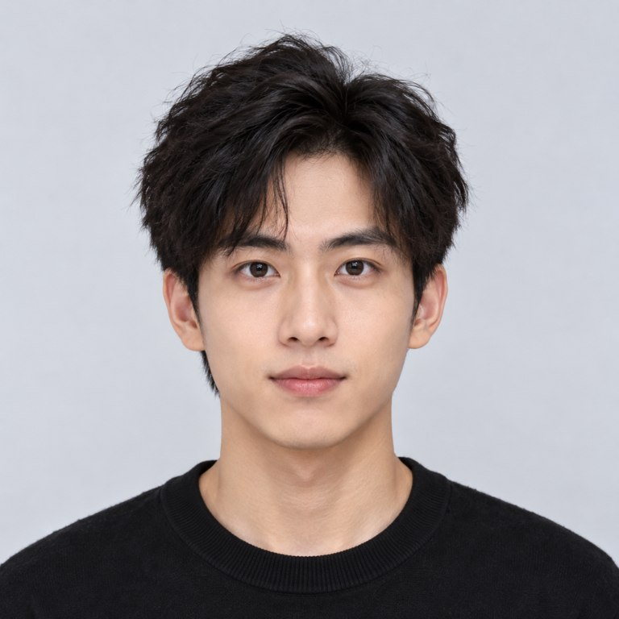
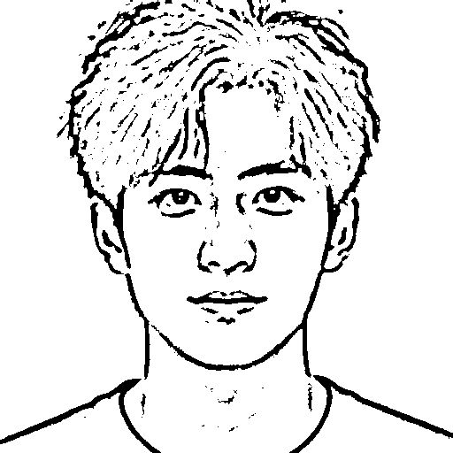
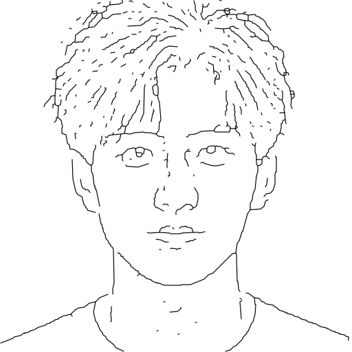
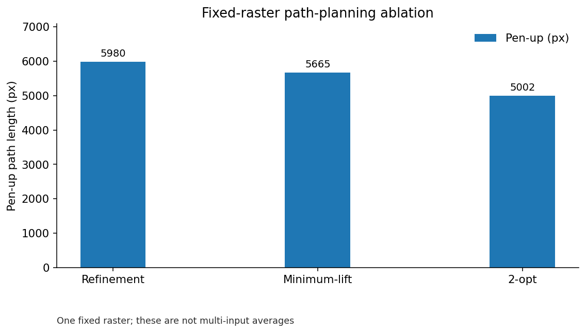
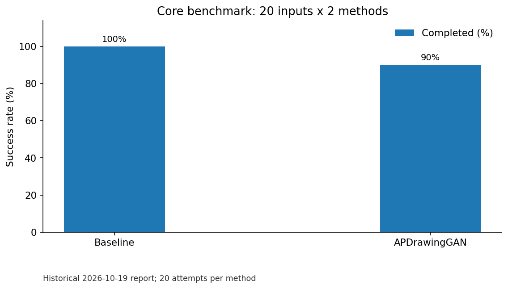
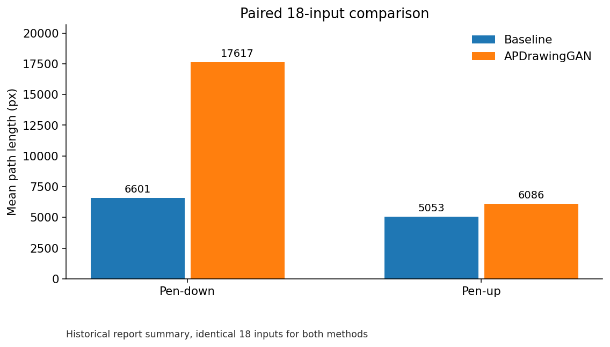
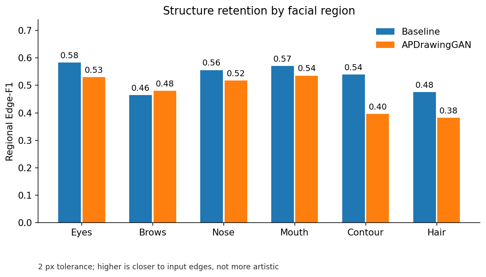

# 机器人肖像绘制艺术风格学习（L1）

**RobotPortraitArt 技术实现与实验分析报告**

> **文档类型：** 课程技术报告与历史实验分析（2026-10-24 文档校订版）
> **历史核心实验：** 2026-10-19；实验提交 `0f0426a`（`feat/evaluation-benchmark`）
> **公开软件版本参照：** `v1.0.1`（`10a6b78b753b75796a2dc6343b4a71e7aa17bb0a`）
> **证据范围：** 实验数值沿用原报告已记录的汇总结果；本次文档校订**未重新运行** 40 次 Benchmark，也未从原始 CSV 重新计算统计量。
> **重要区分：** 公开仓库的 4 张 AI 合成示例用于产品演示，**不是**本报告历史 20 张 Core Benchmark 的替代样本；完整 Benchmark 原始输入及 `outputs/` 结果不包含在公开源码包中。

---

## 摘要

本项目面向“机器人肖像绘制艺术风格学习”任务，构建了一套从普通人像照片到艺术线稿、再到面向机器人绘制的二维矢量轨迹的端到端系统。系统以确定性传统图像处理方法作为 Baseline，并集成 APDrawingGAN 作为学习式艺术肖像生成器；在生成端之前加入 YuNet 五点人脸检测、相似变换对齐与 PPHumanSeg 人像分割，在生成端之后完成中心线矢量化、图结构精炼、最少笔画轨迹覆盖（Minimum-Lift Trail Cover）以及基于 2-opt 的跨笔画顺序优化，最终输出适于机器人绘制的 SVG 与轨迹数据。同时，项目实现了 FastAPI 后端与 Vue 3 前端，用于任务创建、状态查看、结果对比与机器人绘制动画展示。

为保证评价具有可复现性，项目锁定了一个包含 20 张核心人像的基准集，其中包括标准样本、小脸、暗光、低清晰度、大姿态旋转以及额外本地真实照片。正式端到端实验共执行 40 次（20 张 × 2 种方法），其中 Baseline 完成 20/20，成功率为 100%；APDrawingGAN 完成 18/20，成功率为 90%。两例失败均集中在大姿态旋转样本，并发生于 APDrawingGAN 自动预处理的 YuNet 人脸检测阶段。对两种方法共同成功的 18 个样本进行严格配对比较后，APDrawingGAN 相比 Baseline 的平均笔画数增加约 76.0%，落笔路径长度增加约 166.9%，而抬笔移动距离仅增加约 20.4%；两种方法的 2-opt 平均抬笔改善率分别为 12.85% 和 11.38%，表明在本测试集上，路径排序优化对两类不同复杂度的线稿均能稳定降低一部分抬笔空移。

由于测试集不存在逐样本的独立艺术线稿真值，本项目没有将照片与艺术化线稿之间的 SSIM、LPIPS 等指标直接解释为“艺术质量”。为减少大规模人工逐图评分的主观性与工作量，项目进一步设计了基于面部区域的自动结构保真度评价：使用 YuNet 定位眼、眉、鼻、嘴、轮廓与头发区域，并以各方法实际使用的预处理照片结构边缘为参考，在 2 像素容差下计算区域 Edge-F1。18 对样本的平均区域 Edge-F1 为 Baseline 0.5318、APDrawingGAN 0.4738。该结果表明 APDrawingGAN 输出与照片局部边缘的一致性整体较低，差异尤其体现在轮廓与头发区域。结合其艺术化生成目标，这种差异可被理解为局部结构重构的一部分，但该指标仍只能解释为“结构保持程度”，不能简单等价为主观艺术质量。

综合实验表明，本项目不仅完成了照片到艺术肖像的生成，还将生成结果进一步转化为具有明确机器人运动代价的矢量轨迹，并通过最少笔画覆盖和路径顺序优化实现了可量化的绘制效率改进。系统当前最明显的鲁棒性瓶颈是大姿态人脸的自动关键点检测，而非 GAN 推理、分割或矢量化本身。

**关键词：** 机器人绘画；肖像生成；APDrawingGAN；生成对抗网络；人脸对齐；中心线矢量化；图论；路径规划；2-opt；结构保真度


### 阅读与复现说明

- **报告中的“20 张 / 40 次 / 18 对”**均指 2026-10-19 的历史 Core Benchmark，而非 README 里的 4 张合成演示图片。`local` 类别涉及非公开输入；不得因仓库缺少原始照片而声称任何人均可直接复现同一数值。
- 报告所列均值、成功率与 Edge-F1 是**历史实验记录值**。下文插图依据已发表在本报告中的表格重新绘制，属于“汇总数据可视化”，不构成新的实验、独立验证或统计显著性证据。
- 旧实验提交下的 `173 passed` 属于当时的回归快照；后续 `v1.0.1` 的界面、历史记录与预检缓存是在此后完成的功能。两者不要混写。
- 指标以像素、时间和路径几何为单位；本项目**没有实体机械臂执行结果**，因此不声称实际关节可达性、物理绘图误差或绝对作业时长的改善。

文档索引与证据分级见 [文档版本与数据说明](DOCUMENTATION_STATUS.md)。

---

## 1. 项目背景与目标

### 1.1 背景

机器人绘画系统需要同时解决两个性质不同但相互耦合的问题：

1. **视觉生成问题**：如何将普通照片转换为具有明确艺术风格、适合线描表达的人像；
2. **机器人执行问题**：如何把栅格图像转换为连续、稳定、尽可能少抬笔的运动轨迹。

仅解决第一个问题，系统仍停留在“图像风格迁移”；仅解决第二个问题，又无法体现学习式艺术风格。本项目因此将两者统一到同一条工程链路中：

```text
照片
  ↓
人脸检测 / 对齐 / 分割
  ↓
艺术肖像生成
  ↓
中心线矢量化
  ↓
图结构精炼
  ↓
最少笔画轨迹覆盖
  ↓
跨笔画顺序优化
  ↓
SVG / 机器人绘制轨迹
```

项目参考的核心工作包括 APDrawingGAN、GANs N' Roses 与 U-GAT-IT。其中，本项目实际集成并用于正式实验的是 **APDrawingGAN**；GANs N' Roses 与 U-GAT-IT 主要作为艺术风格生成与图像到图像转换方向的相关工作参考，并未在本项目中实现或纳入正式对照实验。

### 1.2 项目目标

本项目的主要目标包括：

- 建立一个从人像照片到机器人绘制轨迹的完整端到端系统；
- 集成 APDrawingGAN，使系统具备学习式艺术肖像生成能力；
- 建立可自动运行的 YuNet + Alignment + PPHumanSeg 预处理链；
- 将艺术线稿转换为适合机器人执行的中心线矢量路径；
- 在图论层面减少笔画数量，并在几何层面减少笔画之间的空移距离；
- 实现可复现的 Benchmark，分别评价生成链鲁棒性、路径复杂度、运行效率和结构保真度；
- 提供 Web Demo，用于输入、任务状态、A/B 对比、结果预览和机器人绘制动画展示。

### 1.3 项目范围与边界

需要明确的是，本项目**没有从零训练新的 GAN，也没有对 APDrawingGAN 进行重新训练或微调**。项目工作的重点是：

- 将预训练 APDrawingGAN 接入实际照片输入；
- 自动化其原本较依赖预处理的数据流程；
- 将生成结果进一步转换成机器人可执行路径；
- 针对路径规划、鲁棒性和端到端工程链进行系统评价。

因此，本项目的主要贡献更接近“**学习式艺术生成模型的机器人绘画系统集成与路径优化**”，而非新的生成网络结构设计。

---

## 2. 相关工作

### 2.1 APDrawingGAN

APDrawingGAN 由 Yi 等人在 CVPR 2019 提出 [1]，面向“人脸照片 → 艺术肖像线稿”的生成任务。该方法的关键思想是使用全局与局部层次化生成器/判别器，使不同面部区域可以采用不同的绘制策略，并通过距离变换相关的损失处理艺术家线条与照片边缘并不严格对齐的问题。

这项工作与本项目高度契合，原因在于其目标输出本身就是稀疏、线性的艺术肖像，而不是传统意义上的彩色风格迁移图像。因此，本项目选取 APDrawingGAN 作为主要学习式生成器，并重点解决其自动预处理、Windows/WSL 推理集成、矢量化和机器人轨迹规划问题。

### 2.2 GANs N' Roses

GANs N' Roses [2] 研究稳定、可控、多样的 image-to-image translation，并将内容编码与风格编码分离，以产生多样的动漫风格输出。其价值主要体现在“内容一致性与风格多样性”的建模思想。

本项目没有直接实现该方法，但它为未来“同一张人像生成多种机器人绘画风格”提供了参考方向。

### 2.3 U-GAT-IT

U-GAT-IT [3] 是一种无监督图像到图像转换方法，引入注意力机制和 AdaLIN（Adaptive Layer-Instance Normalization），以控制几何和纹理变化。其思路表明，生成模型可以通过注意力自动关注源域与目标域差异显著的区域。

在本项目中，U-GAT-IT 主要作为后续可扩展艺术风格生成器的参考，而不是正式实现模块。

---

## 3. 系统总体设计

### 3.1 系统架构

**图 1：系统数据流（与实际代码模块对应，概念示意）**



> 图 1 仅表示软件中执行的逻辑链路。Baseline 和 APDrawingGAN 的预处理条件不同；最后的动画是二维 SVG 预览，不代表实际机械臂运动。




### 3.2 主要模块

| 模块 | 主要职责 |
|---|---|
| 输入与通用预处理 | 读取照片、尺寸规范化、生成统一输入 |
| YuNet | APDrawingGAN 自动五点人脸关键点检测 |
| Alignment | 基于五点的相似变换，将脸部规范到 512×512 |
| PPHumanSeg | 自动生成人像/背景区域掩码 |
| Baseline | 确定性传统图像处理线稿生成 |
| APDrawingGAN | 学习式艺术肖像线稿生成 |
| Centerline Vectorization | 将栅格黑线转换为单像素中心线和图结构 |
| Graph Refinement | 清理局部拓扑、收缩 junction cluster |
| Minimum-Lift | 在图拓扑约束下最小化笔画条数 |
| 2-opt | 优化不同笔画之间的访问顺序，降低 pen-up 距离 |
| FastAPI | 创建任务、查询状态、读取 manifest 与输出文件 |
| Vue 3 Web | 上传、A/B 对比、结果预览、机器人绘制动画 |

### 3.3 后端接口

当前后端提供：

| 接口 | 功能 |
|---|---|
| `GET /api/health` | 健康检查 |
| `GET /api/methods` | 查询可用生成方法 |
| `POST /api/jobs` | 创建异步绘制任务 |
| `GET /api/jobs/{job_id}` | 查询任务状态 |
| `GET /api/jobs/{job_id}/manifest` | 获取任务 manifest |
| `GET /api/jobs/{job_id}/files/{filename}` | 获取任务输出文件 |

任务状态采用 `queued → running → completed / failed` 流程。

---

### 3.4 开放示例与历史实验样本的区别

**图 2：公开合成样例的实际 Baseline → Centerline 演示（非 Core Benchmark 样本）**

| 示例输入 | OpenCV Baseline 输出 | SVG 路径回栅格预览 |
|:--:|:--:|:--:|
|  |  |  |

> 图 2 来自仓库公开合成示例的实际处理结果，只展示软件输入输出形式；它**不是**后文固定 Raster E3–E5 输入，也不是 APDrawingGAN 或历史 20 张 Core Benchmark 的统计样本。

---

## 4. 核心算法设计

### 4.1 Baseline 生成器

Baseline 使用传统、确定性的图像处理流程产生黑白人像线稿，其主要作用有两个：

1. 提供不依赖深度学习的可靠工程基线；
2. 用于比较学习式艺术生成在路径复杂度、结构保持和运行代价方面带来的变化。

Baseline 的优势是速度快、失败率低、输出与输入图像局部边缘联系直接；缺点是艺术抽象能力有限，容易保留过多摄影图像中的边缘或纹理特征。

---

### 4.2 APDrawingGAN 自动预处理

APDrawingGAN 原始工作流对人脸预处理有较强依赖。本项目将其自动化为：

```text
Input Photo
  ↓
YuNet Five-point Face Detection
  ↓
Similarity Alignment
  ↓
512×512 Aligned Portrait
  ↓
PPHumanSeg Mask
  ↓
APDrawingGAN Inference
```

#### 4.2.1 YuNet 五点检测

检测五个关键点：

- right eye
- left eye
- nose tip
- right mouth corner
- left mouth corner

这些点用于后续相似变换。正式生成链使用较严格的 YuNet 置信度设置，因此对大姿态旋转样本较敏感，这一点在正式实验中形成了两个可复现的失败案例。

#### 4.2.2 相似变换对齐

通过人脸五点估计相似变换，将输入照片映射到 APDrawingGAN 所需的标准 512×512 空间。对齐阶段记录：

- scale
- rotation angle
- RMS alignment error

这些信息写入 manifest，可用于回溯预处理质量。

#### 4.2.3 PPHumanSeg 人像掩码

自动生成前景人像掩码，替代纯手工 mask 输入。系统同时记录前景比例等元数据，以便排查分割异常。

---

### 4.3 中心线矢量化

生成模型输出的本质仍是栅格图像，而机器人需要连续路径。因此，本项目不是简单提取外轮廓，而是将黑色笔画转化为中心线图结构。

中心线方式相比“双边轮廓”更适合画笔/机械臂，因为：

- 更接近“单次笔触”的语义；
- 避免一根粗线被机器人沿左右边界画两遍；
- 更适合后续图论式 trail decomposition；
- 路径长度更接近实际绘画动作。

---

### 4.4 图结构精炼与 Junction Cluster Contraction

骨架化后的像素图容易在交叉点附近产生多个相邻高阶节点，直接进行路径分解会人为制造大量短笔画。

因此系统对 junction cluster 进行聚类与收缩，将局部复杂交叉区域归并为更稳定的图节点。

其作用是：

- 减少像素骨架噪声产生的伪分叉；
- 降低 trail fragmentation；
- 为后续理论最少笔画覆盖创造更稳定的拓扑结构。

---

### 4.5 Minimum-Lift Trail Cover

#### 4.5.1 问题定义

机器人完成一条 stroke 后若要移动到下一条 stroke，需要抬笔。抬笔次数和抬笔距离都会降低绘制效率。

因此第一层目标是在不重复绘制图边的条件下，尽可能用更少的 trails 覆盖整张图。

对于一个具有边的连通分量，若其奇度顶点数为 \(o\)，则覆盖所有边所需的最少 trail 数为：

\[
T_{\min} =
\begin{cases}
1, & o = 0 \\
o/2, & o > 0
\end{cases}
\]

整张图的理论最少 trail 数为各连通分量结果之和。

#### 4.5.2 项目实现目标

项目记录：

- `connected_component_count`
- `odd_vertex_count`
- `theoretical_min_trail_count`
- `stroke_count`
- `edge_reuse_count`

当：

```text
stroke_count == theoretical_min_trail_count
edge_reuse_count == 0
```

时，说明在当前图结构上已经达到“不重复边条件下”的最少笔画条数。

这里的“最优”仅针对**图论 trail 数量**，不意味着跨 trail 的空间访问顺序已经达到全局最短。

---

### 4.6 跨笔画排序与 2-opt

完成最少 trail 分解后，仍需决定这些 trail 的执行顺序和方向。

#### 4.6.1 Pen-down 与 Pen-up

定义：

- **Pen-down length**：机器人落笔绘制的总轨迹长度；
- **Pen-up length**：机器人抬笔后，从一条 stroke 终点移动到下一条 stroke 起点的总距离。

若 stroke 序列为 \(S_1,\dots,S_n\)，则：

\[
D_{\text{up}}
=
\sum_{i=1}^{n-1}
\left\|
\operatorname{end}(S_i)
-
\operatorname{start}(S_{i+1})
\right\|_2
\]

路径排序优化的主要目标是降低 \(D_{\text{up}}\)，而不改变实际绘制内容。

#### 4.6.2 2-opt

系统首先建立确定性 greedy 顺序，再使用 2-opt 对 stroke 顺序进行局部搜索。

记录指标包括：

- `two_opt_improvement_px`
- `two_opt_improvement_ratio`
- `two_opt_move_count`
- `two_opt_pass_count`

2-opt 不是全局最优求解器，因此报告中不宣称其得到“全局最短路线”；它提供的是可复现、低复杂度且效果稳定的局部改进。

---

## 5. 固定栅格路径优化验证

在进入 20 张人脸的正式 Benchmark 前，项目使用固定栅格图对中心线图与轨迹规划进行独立验证。

固定栅格 SHA256：

```text
13A35D6DC7E0E8831E8C0DBAD6ED0714C0ACA0BEF0F75FCCD7A5439A6ED696ED
```

### 5.1 阶段性结果

| 阶段 | Stroke Count | Theoretical Min | Pen-up / px | Pen-down / px | Edge Reuse |
|---|---:|---:|---:|---:|---:|
| Graph Refinement | 713 | — | 5980.14 | 15592.30 | — |
| Minimum-Lift | 431 | **431** | 5665.22 | 15602.68 | **0** |
| Minimum-Lift + 2-opt | **431** | **431** | **5001.77** | 15602.68 | **0** |



**图 3：** 根据本节同一固定栅格的表格重绘 pen-up 长度（px），不可解释为跨样本统计。

关键观察：

- Minimum-Lift 将笔画数从 713 降至 431；
- `431 == theoretical_min_trail_count`，达到当前图结构的理论最少 trail 数；
- `edge_reuse_count = 0`，没有通过重复绘制边来换取更少笔画；
- 2-opt 不改变 stroke 数和 pen-down 内容；
- 相比 greedy 顺序，2-opt 减少约 **663.44 px** pen-up，改善约 **11.71%**；
- 从较早图优化阶段到最终结果，pen-up 总体下降约 **16.36%**。

这组实验验证了“拓扑优化”和“几何访问顺序优化”是两个不同层次：

1. Minimum-Lift 解决“需要多少笔”；
2. 2-opt 解决“这些笔按什么顺序画”。

---

## 6. Benchmark 数据集设计

### 6.1 数据集版本

正式实验使用：

```text
outputs/benchmark_faces_v1_3
```

对应锁定版本：

> RobotPortraitArt Benchmark Faces V1

数据集锁定后，不再根据实验结果重新采样、修改随机种子或替换困难样本。

### 6.2 Core 与 Stress/OOD

### Core：20 张

| 类别 | 数量 | 设计目的 |
|---|---:|---|
| easy | 3 | 标准、较容易的人脸输入 |
| small_face | 3 | 人脸面积较小 |
| dark | 3 | 偏暗输入 |
| soft | 3 | 清晰度较低 / 较柔和输入 |
| rotated | 3 | 姿态旋转与关键点检测压力测试 |
| reserve_standard | 1 | 额外标准样本 |
| local | 4 | 非 CelebA 的本地真实照片 |
| **合计** | **20** | 正式核心 Benchmark |

其中公开人脸数据来自 CelebA 的固定候选选择；额外加入 4 张本地真实照片，用于验证系统在非 CelebA 输入上的端到端适应性。

### Stress/OOD：1 张

另保留 1 张非标准人脸风格的插画/动漫图像作为 Stress/OOD 样本。该样本不参与 Core 20 的正式均值统计，而用于展示自动人脸检测在明显域外输入上的边界。

---

## 7. 实验设置

### 7.1 正式端到端实验参数

| 参数 | 设置 |
|---|---|
| Benchmark group | `core` |
| 样本数 | 20 |
| Methods | `baseline`, `apdrawinggan` |
| 总运行数 | 40 |
| 图像尺寸 | 512 |
| Seed | 42 |
| Vector config | `configs/centerline.yaml` |
| APDrawingGAN timeout | 180 s |
| APD 自动预处理 | YuNet + Alignment + PPHumanSeg |

正式命令：

```powershell
python scripts/benchmark_end_to_end.py `
  --benchmark-dir "outputs/benchmark_faces_v1_3" `
  --output-dir "outputs/evaluation_benchmark" `
  --group core `
  --methods baseline apdrawinggan `
  --config "configs/centerline.yaml" `
  --size 512 `
  --seed 42 `
  --apd-python "/home/YOUR_USER/.venvs/robotportrait-apd/bin/python" `
  --apd-timeout 180
```

### 7.2 运行环境

APDrawingGAN 推理环境记录如下：

| 项目 | 环境 |
|---|---|
| Host | Windows + WSL |
| WSL | Ubuntu 22.04 |
| APD Python | Python 3.10.12 |
| PyTorch | 2.5.1+cu121 |
| GPU | NVIDIA GeForce RTX 4060 Laptop GPU |
| GPU Memory | 8188 MiB |
| Checkpoint | `third_party/APDrawingGAN/checkpoints/formal_author/300_net_gen.pt` |
| Checkpoint size | 255,222,836 bytes |

APDrawingGAN 使用独立 WSL Python：

```text
/home/YOUR_USER/.venvs/robotportrait-apd/bin/python
```

这一设计避免 Windows 主环境与旧版 APDrawingGAN/PyTorch 依赖之间的冲突。

---

## 8. 评价指标

### 8.1 端到端成功率

定义：

\[
SuccessRate = \frac{N_{\text{completed}}}{N_{\text{attempted}}}
\]

用于衡量实际系统从输入照片到最终轨迹输出的鲁棒性。

---

### 8.2 机器人绘制复杂度

主要指标：

- Stroke count
- Pen-down length
- Pen-up length
- Theoretical minimum trail count
- Edge reuse count
- SVG bytes

这些指标分别对应：

- 抬笔次数相关复杂度；
- 实际绘画工作量；
- 无效空中运动；
- 图拓扑最少笔画下界；
- 是否发生重复绘边；
- 输出路径数据规模。

---

### 8.3 路径优化效果

使用：

\[
ImprovementRatio =
\frac{D_{\text{greedy}} - D_{\text{2opt}}}
{D_{\text{greedy}}}
\]

评价 2-opt 对 pen-up 距离的改善。

---

### 8.4 运行时间

记录：

- preprocess time
- generate time
- vectorize time
- rasterize time
- total pipeline time
- wall-clock time

正式报告中的算法比较优先使用 pipeline 内部 `total_ms`；`wall_time_ms` 还会包含进程启动、WSL、文件系统和 Python 解释器等额外开销。

---

### 8.5 为什么不直接把 SSIM / LPIPS 当作艺术质量

照片与艺术线稿属于不同视觉域。一个成功的艺术化模型可能主动：

- 删除皮肤纹理；
- 简化头发；
- 改写轮廓线；
- 重新组织局部阴影；
- 使用与真实照片边缘不严格重合的艺术笔触。

因此：

> “与原照片像素越相似”并不等价于“艺术肖像质量越高”。

本项目已有的 SSIM / Edge-F1 / 可选 LPIPS 工具，只有在存在**独立的真实风格参考图**时，才适合作为风格输出的定量参考。不能把“PNG → SVG → PNG 的自重建一致性”或“照片 → 艺术线稿的一致性”误写为艺术质量。

---

### 8.6 自动区域结构保真度

为了替代 36 张结果 × 6 区域的大规模人工评分，本项目新增：

```text
scripts/evaluate_structural_fidelity.py
```

评价区域：

- eyes
- eyebrows
- nose
- mouth
- contour
- hair

流程：

```text
Method-specific Photo Input
  ↓
YuNet ROI Localization
  ↓
Photo Structural Edges
  ↓
Generated Line Pixels
  ↓
Tolerance-aware Regional Edge Matching
  ↓
Precision / Recall / F1
```

使用 2 px 容差计算区域 Edge-F1。

### 评价阶段 YuNet 阈值说明

结构评价中，Baseline 以其 `prepared.png` 为结构参考，APDrawingGAN 优先以 `apdrawinggan_preprocess/aligned.png` 为结构参考；这样评价区域与各方法实际生成结果所在的坐标系保持一致。

结构评价 V1 使用较高的 ROI 定位阈值时，`public_06 / baseline` 出现一次评价定位失败。该样本的 Baseline 生成本身是成功的，失败仅发生于“评价脚本定位 ROI”的 YuNet 阶段。

因此最终 V2 将**评价专用** YuNet threshold 设置为 0.50，使 18 对样本全部完成：

```text
Paired samples = 18
Rows           = 36
Baseline       = 18
APDrawingGAN   = 18
Failures       = 0
```

这一阈值调整不会重新生成任何肖像，也不会改变前述正式 40 次端到端 Benchmark，只用于保证评价区域可以被完整定位。

---

## 9. 正式端到端实验结果

### 9.1 成功率

| Method | Attempted | Completed | Failed | Success Rate |
|---|---:|---:|---:|---:|
| Baseline | 20 | 20 | 0 | **100%** |
| APDrawingGAN | 20 | 18 | 2 | **90%** |
| Overall | 40 | 38 | 2 | **95%** |



**图 4：** 根据正式 20 张 Core Benchmark 的汇总成功次数绘制；分母均为 20。失败保留在统计中。

两个 APDrawingGAN 失败样本均位于 `rotated` 类别：

- `public_13`
- `public_14`

异常类型均为：

```text
FaceNotDetectedError
YuNet 未检测到人脸
```

因此当前端到端失败的直接原因是**自动五点人脸检测**，不是：

- APDrawingGAN checkpoint 缺失；
- CUDA/GPU 推理失败；
- PPHumanSeg 分割失败；
- SVG 写出失败；
- 矢量路径规划失败。

---

### 9.2 分类别结果

> 下表的均值均基于各方法在对应类别中**成功完成的样本**。因此 `rotated` 类别中 Baseline 的均值来自 3 张，而 APDrawingGAN 的均值仅来自 1 张，不应把两者直接解释为严格配对均值。

| Category | Baseline Success | APD Success | Baseline Stroke | APD Stroke | Baseline Pen-up / px | APD Pen-up / px | Baseline Total / ms | APD Total / ms |
|---|---:|---:|---:|---:|---:|---:|---:|---:|
| easy | 3/3 | 3/3 | 356.00 | 468.00 | 5912.90 | 5227.64 | 1458.00 | 9386.62 |
| small_face | 3/3 | 3/3 | 417.67 | 589.00 | 7008.17 | 6811.93 | 2009.31 | 11106.42 |
| dark | 3/3 | 3/3 | 203.33 | 512.67 | 3768.62 | 6324.72 | 980.94 | 10513.08 |
| soft | 3/3 | 3/3 | 223.00 | 539.33 | 4129.20 | 6014.82 | 987.52 | 13339.78 |
| rotated | 3/3 | **1/3** | 413.00 | 463.00 | 6300.08 | 5702.84 | 1872.54 | 8985.71 |
| reserve_standard | 1/1 | 1/1 | 387.00 | 623.00 | 6130.02 | 7035.09 | 1610.46 | 11215.44 |
| local | 4/4 | 4/4 | 229.75 | 456.25 | 4314.72 | 5916.25 | 881.35 | 9909.76 |

#### 9.2.1 Easy

APDrawingGAN 的笔画数比 Baseline 更多，但平均 pen-up 反而更低。这说明“线稿更复杂”并不必然导致“空移更多”；stroke 的空间布局和跨 stroke 排序同样重要。

#### 9.2.2 Small Face

两种方法均 3/3 成功，说明在成功完成 YuNet/对齐后，小脸并不是 APDrawingGAN 端到端链路的必然失败因素。

#### 9.2.3 Dark

APDrawingGAN 在这 3 个暗光样本上仍全部完成，同时输出笔画复杂度高于 Baseline。由于该类别仅包含 3 个样本，这一结果只能说明暗光在本组样本中没有直接造成端到端失败，不能据此作一般性的因果推断。

#### 9.2.4 Soft

APDrawingGAN 同样为 3/3 成功，但该类别的平均总耗时最高，约 13.34 s。该现象提示低清晰度样本可能伴随更高的生成或后处理开销，但受样本量限制，不将其解释为普遍因果关系。

#### 9.2.5 Rotated

这是最明显的系统鲁棒性弱点：

```text
Baseline:     3 / 3 = 100%
APDrawingGAN: 1 / 3 = 33.3%
```

两例失败均发生于 APDrawingGAN 前置 YuNet 检测，因此当前系统需要优先改善的不是 GAN 本体，而是大姿态条件下的人脸定位与 fallback 策略。

#### 9.2.6 Local

4 张额外本地真实照片在两种方法上均全部完成。该结果为系统处理非 CelebA 实际照片提供了初步支持，但样本量仅为 4，不足以代表更广泛真实场景的泛化能力。

---

## 10. 18 个共同成功样本的严格配对比较

由于总体统计中 Baseline 有 20 个成功样本，而 APDrawingGAN 只有 18 个成功样本，直接比较 20 vs 18 的均值会引入样本集合差异。

因此正式方法间比较采用：

```text
APDrawingGAN status == completed
        ↓
获取 18 个 sample_id
        ↓
从 Baseline 中取同样的 18 个 sample_id
        ↓
18 vs 18 paired comparison
```

### 10.1 配对结果

| Metric | Baseline | APDrawingGAN | APD Relative Change |
|---|---:|---:|---:|
| N | 18 | 18 | — |
| Stroke Count | 291.61 | 513.22 | **+76.0%** |
| Pen-down Length / px | 6600.94 | 17616.76 | **+166.9%** |
| Pen-up Length / px | 5053.40 | 6085.57 | **+20.4%** |
| 2-opt Improvement | 12.85% | 11.38% | **-1.47 pct** |
| Vectorization Time / ms | 898.98 | 4115.66 | **4.58×** |
| Total Time / ms | 1290.91 | 10715.44 | **8.30×** |
| SVG Bytes | 45889.94 | 88881.28 | **+93.7%** |



**图 5：** 18 个共同成功样本的路径长度均值，来源为上表的聚合数据；未提供误差棒，不代表已计算置信区间或统计显著性。

### 10.2 结果解释

**统计限制：** 本报告列出的是配对样本的指标均值与均值的相对变化，尚未提供各样本的差值分布、标准差、95% 置信区间或成对显著性检验。因而不能仅凭下表宣称不同方法存在统计学显著差异。表中计算口径以原汇总文件为准，若将来提供原始逐样本 CSV，应重新核对聚合方式（特别是“平均百分比”与“均值之比”可能不同）。


APDrawingGAN 的平均笔画数增加约 76%，pen-down 增加约 167%，说明其输出包含明显更多的可绘制线条。

但值得注意的是：

```text
Pen-down: +166.9%
Stroke:   +76.0%
Pen-up:   +20.4%
```

即使实际绘制内容增长非常明显，无效空移并没有同比增长。

在本组配对数据中，pen-up 的相对增幅明显低于 stroke count 与 pen-down 的增幅，这一现象与路径规划抑制跨笔画空移的设计目标一致；它不意味着更复杂的线稿在所有情况下都只会带来有限的空移增长。

---

## 11. 2-opt 路径优化分析

Baseline：

```text
mean 2-opt improvement = 12.85%
```

APDrawingGAN：

```text
mean 2-opt improvement = 11.38%
```

两种方法的**样本平均**改善率约为 11%–13%；仅凭这两个均值无法判断每个样本的改善幅度是否稳定。

因此可以得到一个重要工程结论：

> 从当前 18 对样本看，2-opt 在 Baseline 与 APDrawingGAN 两种上游生成结果上均能稳定削减一部分 pen-up 空移，因此该优化具有一定的跨生成方法适用性。

这比仅在单张固定图片上验证 2-opt 更有意义，因为 18 对真实人脸说明该优化具有跨样本稳定性。

需要注意的是，2-opt 只证明“相对 greedy 的局部改进”，不能据此宣称获得全局最短跨笔画路径。

---

## 12. 自动结构保真度结果

### 12.1 最终 V2 结果

| Region | Baseline Edge-F1 | APDrawingGAN Edge-F1 | APD − Baseline | Relative Change |
|---|---:|---:|---:|---:|
| Eyes | **0.5833** | 0.5305 | -0.0528 | -9.0% |
| Eyebrows | 0.4646 | **0.4805** | **+0.0158** | **+3.4%** |
| Nose | **0.5560** | 0.5182 | -0.0378 | -6.8% |
| Mouth | **0.5714** | 0.5357 | -0.0357 | -6.2% |
| Contour | **0.5402** | 0.3960 | **-0.1443** | **-26.7%** |
| Hair | **0.4753** | 0.3822 | **-0.0931** | **-19.6%** |
| **Regional Mean** | **0.5318** | 0.4738 | **-0.0580** | **-10.9%** |



**图 6：** 根据区域 Edge-F1 汇总值绘制。F1 表示相对输入结构边缘的匹配，不是审美评价；横向比较不能用于判定“谁的艺术风格更优”。

### 12.2 如何正确解释该表

这个表不能解读为：

> “APDrawingGAN 的艺术质量比 Baseline 低 10.9%。”

正确解释是：

> 在当前基于照片局部结构边缘的自动代理评价中，Baseline 对输入照片边缘的保持程度更高；APDrawingGAN 作为艺术化模型，会主动简化、重组和重新绘制局部结构，因此 Edge-F1 较低。

尤其是：

- **Eyebrows**：APDrawingGAN 略高；
- **Contour**：APDrawingGAN 下降最大；
- **Hair**：APDrawingGAN 下降第二明显。

这与艺术肖像任务的性质并不矛盾。头发和脸部外轮廓本身就是艺术家常进行抽象、概括和重组的区域，因此像素级边缘一致性更容易下降。

---

### 12.3 逐样本 Regional Mean F1

| Sample | Category | Baseline | APDrawingGAN | Better Structural F1 |
|---|---|---:|---:|---|
| local_01 | local | 0.6937 | **0.7287** | APD |
| local_02 | local | **0.4581** | 0.3469 | Baseline |
| local_03 | local | **0.4745** | 0.3980 | Baseline |
| local_04 | local | **0.4827** | 0.2559 | Baseline |
| public_01 | easy | 0.6108 | **0.6896** | APD |
| public_02 | easy | 0.5895 | **0.6293** | APD |
| public_03 | easy | 0.5864 | **0.5887** | APD |
| public_04 | small_face | **0.4495** | 0.1543 | Baseline |
| public_05 | small_face | **0.6615** | 0.6365 | Baseline |
| public_06 | small_face | 0.5533 | **0.6141** | APD |
| public_07 | dark | **0.3209** | 0.1379 | Baseline |
| public_08 | dark | **0.4687** | 0.3781 | Baseline |
| public_09 | dark | **0.6087** | 0.5705 | Baseline |
| public_10 | soft | 0.6059 | **0.6647** | APD |
| public_11 | soft | **0.3290** | 0.0744 | Baseline |
| public_12 | soft | **0.4538** | 0.3648 | Baseline |
| public_15 | rotated | **0.6327** | 0.6087 | Baseline |
| public_16 | reserve_standard | 0.5932 | **0.6881** | APD |

从逐样本数据可以看到，APDrawingGAN 并非在所有输入上结构 F1 都更低。它在多个标准或较高质量样本上可以达到甚至超过 Baseline，但在部分 small-face、dark 和 soft 样本上出现较明显下降。

因此，一个更准确的结论是：

> 在当前测试集上，APDrawingGAN 的结构 F1 呈现更大的样本间波动，并在部分 small-face、dark 与 soft 样本上出现低值。该现象提示其结构保持对输入与生成状态更敏感，但由于各类别样本量较小，不能将差异简单归因于某一种输入因素。

---

## 13. 生成复杂度与机器人执行代价的权衡

本项目最重要的观察之一，是“生成复杂度”和“机器人执行代价”不能用单一指标评价。

### 13.1 APDrawingGAN 更复杂

APDrawingGAN 相比 Baseline：

- Stroke：+76.0%
- Pen-down：+166.9%
- SVG size：+93.7%
- Vectorization time：4.58×
- Total time：8.30×

这些结果表明，在当前样本上，APDrawingGAN 产生了更多笔画、更长的 pen-down 路径以及更大的 SVG 数据规模，即可绘制图结构复杂度更高；这些复杂度指标本身不代表艺术质量高低。

### 13.2 空移增长低于绘制内容增长

与此同时：

- Pen-up 只增加 20.4%；
- 两种方法 2-opt 都保持约 11%–13% 的改善。

因此，从机器人执行代价角度看，路径规划不仅承担格式转换，还直接影响跨笔画空移，是系统中具有独立评价价值的优化模块。

### 13.3 不应追求单一“总分”

如果将以下指标简单加权为一个总分：

- 风格表现；
- Edge-F1；
- stroke count；
- pen-up；
- runtime；

则权重本身会成为主观选择，并掩盖系统真实的 trade-off。

因此，本报告采用双维度解释：

```text
A. Visual / Structural Side
   → Regional Structural Fidelity
   → Representative Visual Cases

B. Robot Execution Side
   → Success Rate
   → Stroke Count
   → Pen-down
   → Pen-up
   → 2-opt Improvement
   → Runtime
```

这样的评价方式更符合“艺术生成 + 机器人执行”的双重任务属性。

---

## 14. 失败分析

### 14.1 正式 Benchmark 的两个失败

失败：

```text
public_13 / apdrawinggan
public_14 / apdrawinggan
```

类别：

```text
rotated
```

异常：

```text
robot_portrait.apdrawinggan_preprocess.FaceNotDetectedError
```

发生位置：

```text
YuNet detection
```

#### 14.1.1 已观察到的失败边界

日志表明这两次运行均在 YuNet 检测阶段终止，因此**已观察到的直接失败点**不是 APDrawingGAN checkpoint、CUDA 推理、PPHumanSeg 或 Vectorization。需要注意：由于流程没有继续执行到这些后续模块，不能据此证明这些模块在这两张样本上一定不会失败；只能说明它们不是本次运行中首先触发的错误位置。

#### 14.1.2 主要瓶颈

当前最可信的判断是：

> 在当前 Core Benchmark 中，APDrawingGAN 自动链路暴露出的首要鲁棒性瓶颈是大姿态条件下的五点人脸检测。

这是一条非常具体、可继续改进的工程结论。

---

## 15. 工程实现与可复现性

### 15.1 Benchmark Runner

正式 Benchmark 由：

```text
scripts/benchmark_end_to_end.py
```

统一执行。

能力包括：

- generator availability preflight；
- benchmark SHA 校验；
- baseline / APDrawingGAN 串行运行；
- 独立 run directory；
- manifest 解析；
- CSV 汇总；
- JSON summary；
- failures 记录；
- 中断后的 completed-run resume；
- 每次运行独立 console log。

#### 15.1.1 输出结构

```text
outputs/evaluation_benchmark/
├── benchmark_rows.csv
├── benchmark_summary.json
├── failures.json
├── run_metadata.json
└── runs/
    └── <sample_id>/
        ├── baseline/
        └── apdrawinggan/
```

---

### 15.2 Structural Fidelity Evaluator

最终结构评价：

```text
scripts/evaluate_structural_fidelity.py
```

输出：

```text
outputs/structural_fidelity_v2/
├── structural_fidelity_rows.csv
├── structural_fidelity_summary.json
└── structural_fidelity_failures.json
```

最终结果：

```text
Evaluated = 36
Failed    = 0
Paired N  = 18
```

---

### 15.3 版本控制锚点

正式实验相关 Git 提交：

| Commit | Description |
|---|---|
| `f08f7dd` | `feat: add reproducible face benchmark selector` |
| `42540ad` | `feat: add end-to-end evaluation benchmark` |
| `e03fea9` | `feat: add automatic structural fidelity evaluation` |
| `0f0426a` | `fix: align structural fidelity defaults with V2 benchmark` |

基础主线：

```text
3579193
Merge pull request #9 ... feat/web-apdrawinggan
```

因此实验数据可以与明确的代码版本关联，便于复现和答辩说明。

### 15.4 历史实验提交的回归检查（不等于 v1.0.1 全量验证）

在 `0f0426a` 提交后进行了最终代码级回归检查：

| 检查项 | 结果 |
|---|---|
| Python test suite | `173 passed, 1 warning` |
| LPIPS warning | Windows 主环境未安装 `torch`，仅影响可选 LPIPS 指标；正式 APDrawingGAN 使用独立 WSL/CUDA 环境 |
| Frontend typecheck | `vue-tsc -b` 通过 |
| Frontend production build | Vite 8.3.4 构建通过，21 modules transformed |
| Evaluation scripts syntax | `py_compile` 通过 |
| Git whitespace check | `git diff --check` 无错误 |
| Working tree | 检查时保持 clean |

上述检查属于 `0f0426a` 当时的独立快照，只用于确认对应实验评价代码；它既不替代真实机器人硬件测试，也**不应冒充**后来 `v1.0.1` 的回归结果。公开版的本机验收应重新执行 README 中的 `python -m pytest -q`、`npm run typecheck` 与 `npm run build` 并记录执行日期。

---

## 16. 方法学上的严谨性说明

### 16.1 Benchmark 冻结

正式数据集在实验前锁定。没有因为 APDrawingGAN 在 `public_13`、`public_14` 上失败而重新抽样或删除困难样本。

这是必要的，因为如果观察失败后再替换测试数据，会产生明显的 test-set feedback。

### 16.2 失败保留

最终成功率仍报告为：

```text
Baseline     = 100%
APDrawingGAN = 90%
```

没有通过降低正式生成阶段的 YuNet 阈值去“修成 20/20”。

### 16.3 配对统计

方法性能比较使用 18 个共同成功样本，而不是直接比较 Baseline 20 张与 APD 18 张的均值。

这样可以避免因样本集合不同造成的平均值偏移。

### 16.4 结构评价阈值调整的边界

结构评价 V2 将 YuNet threshold 降到 0.50，只用于 ROI 自动定位。

它不是：

- Generator 超参数调优；
- APDrawingGAN 推理参数修改；
- Benchmark 样本修改。

因此它不会改变生成实验本身。

### 16.5 不夸大 Edge-F1

本报告只将 Regional Edge-F1 称为：

> 自动结构保真度代理指标

不将其称为：

- 艺术审美分数；
- 人类偏好分数；
- 风格真实性；
- GAN 质量总分。

---

## 17. 项目局限性

### 17.1 样本规模有限

Core Benchmark 为 20 张，其中部分困难类别仅 3 张。

因此当前实验适合作为课程项目级的工程验证与趋势分析，不足以支持大规模统计结论。

### 17.2 缺少独立风格 Ground Truth

正式 Benchmark 没有为每张输入配套专业艺术家线稿，因此无法计算真正意义上的 supervised style reconstruction accuracy。

### 17.3 缺少多人盲评

本项目最终选择自动结构指标替代 36×6 项手工评分，因此没有人类审美主观评价。

这降低了人工工作量和单人评分偏差，但也意味着：

> “艺术表现更自然/更好看”只能通过代表性案例定性讨论，不能仅凭当前数值指标证明。

### 17.4 APDrawingGAN 前处理对大姿态敏感

正式结果中两例 rotated 失败说明当前单一路径的 YuNet 五点检测没有充分覆盖大姿态情况。

### 17.5 路径排序并非全局最优

2-opt 是局部搜索。

项目已经证明：

- trail count 达到图论最小值；
- 2-opt 相对 greedy 有稳定改善；

但没有证明整个跨 stroke 路径达到旅行商意义上的全局最短。

### 17.6 未进行真实机械臂动力学评价

当前运动指标主要基于二维轨迹几何长度。

尚未纳入：

- 关节速度/加速度限制；
- jerk；
- 实际抬笔 Z 轴成本；
- 机械臂逆运动学奇异性；
- 纸面摩擦与笔尖动力学；
- 真实绘制误差。

因此 `pen-up px` 是一个有效的二维代理指标，但并不等价于真实机器人时间或能耗。

---

## 18. 后续改进方向

### 18.1 人脸检测多级 fallback

针对 rotated 失败，可以设计：

```text
YuNet strict
  ↓ fail
YuNet relaxed
  ↓ fail
rotation sweep
  ↓ fail
secondary face detector
  ↓ fail
manual landmarks
```

正式 Benchmark 的失败结果应保留；该策略应作为新的 robustness experiment 单独评价。

### 18.2 姿态感知预处理

可根据 roll / yaw / pitch 对输入进行：

- 多角度旋转检测；
- 更稳健的人脸 landmark；
- 3D face alignment；
- pose-normalized crop。

### 18.3 多艺术风格生成

未来可以加入：

- GANs N' Roses 风格路线；
- U-GAT-IT；
- CartoonGAN 类方法；
- diffusion-based line-art / portrait stylization。

并保持统一 Generator Interface，使不同生成器复用同一套矢量化和机器人轨迹优化。

### 18.4 真实艺术 Ground Truth

若后续条件允许，可以建立少量：

```text
photo → human artist drawing
```

配对数据。

届时可以更合理地使用：

- SSIM；
- Edge-F1；
- LPIPS；
- perceptual embedding similarity；
- region-wise reference comparison。

### 18.5 小规模盲评而非全量人工评分

无需回到 36×6 的大规模手工表。

更实际的方式是选取 6–10 个具有代表性的案例，进行：

- 匿名 A/B；
- 3–5 名评价者；
- preference rate；
- 结构准确性；
- 艺术性；
- 可辨识度。

这样可以补足自动 Edge-F1 无法表达的主观艺术维度。

### 18.6 面向真实机器人的路径代价模型

未来目标函数可从：

\[
\min D_{\text{pen-up}}
\]

扩展为：

\[
\min
\left(
\alpha T_{\text{motion}}
+
\beta N_{\text{lift}}
+
\gamma J_{\text{smooth}}
+
\delta E_{\text{energy}}
\right)
\]

其中：

- \(T_{\text{motion}}\)：真实执行时间；
- \(N_{\text{lift}}\)：抬笔次数；
- \(J_{\text{smooth}}\)：运动平滑度成本；
- \(E_{\text{energy}}\)：能耗代理。

---

## 19. 结论

本项目完成了一套完整的机器人艺术肖像生成与绘制系统。

从视觉生成侧，系统实现了：

```text
Photo
→ YuNet
→ Alignment
→ PPHumanSeg
→ APDrawingGAN
```

从机器人轨迹侧，系统实现了：

```text
Raster Line-art
→ Centerline
→ Graph Refinement
→ Minimum-Lift Trail Cover
→ 2-opt
→ SVG / Robot Trajectory
```

正式 20 张 Core Benchmark 中：

- Baseline 成功率 **100%**；
- APDrawingGAN 成功率 **90%**；
- 两例 APD 失败均集中于大姿态人脸的 YuNet 检测。

在 18 个共同成功样本上：

- APDrawingGAN stroke 数增加约 **76.0%**；
- pen-down 增加约 **166.9%**；
- pen-up 仅增加约 **20.4%**；
- Baseline / APD 的 2-opt 改善率分别为 **12.85% / 11.38%**；
- 在本组配对数据中，复杂度大幅增加时 pen-up 增幅仍明显低于 pen-down 与 stroke 增幅，并且 2-opt 在两种方法上均保持稳定改善。

自动结构保真度方面：

- Baseline regional Edge-F1 = **0.5318**；
- APDrawingGAN regional Edge-F1 = **0.4738**；
- APD 在眉毛区域略高，但在轮廓与头发区域下降明显。

该结果应解释为“艺术化生成对照片边缘结构的重构更强”，而不是简单解释为“艺术质量更低”。

因此，本项目最终体现出的核心价值不是单纯“使用 GAN 生成一张肖像”，而是建立了一个完整、可复现、可量化的：

> **Photo → Artistic Portrait → Vector Graph → Optimized Robot Drawing**

工程与实验体系。

---

## 参考文献

[1] Yi R, Liu Y J, Lai Y K, Rosin P L. APDrawingGAN: Generating Artistic Portrait Drawings From Face Photos With Hierarchical GANs[C]//Proceedings of the IEEE/CVF Conference on Computer Vision and Pattern Recognition. 2019: 10743–10752. DOI: [10.1109/CVPR.2019.01100](https://doi.org/10.1109/CVPR.2019.01100). [CVF 论文全文](https://openaccess.thecvf.com/content_CVPR_2019/html/Yi_APDrawingGAN_Generating_Artistic_Portrait_Drawings_From_Face_Photos_With_Hierarchical_CVPR_2019_paper.html).

[2] Chong M J, Forsyth D. GANs N' Roses: Stable, Controllable, Diverse Image to Image Translation (works for videos too!)[EB/OL]. arXiv:2106.06561, 2021. [原文](https://arxiv.org/abs/2106.06561).

[3] Kim J, Kim M, Kang H, Lee K. U-GAT-IT: Unsupervised Generative Attentional Networks with Adaptive Layer-Instance Normalization for Image-to-Image Translation[C]//International Conference on Learning Representations (ICLR). 2020. [原文](https://openreview.net/forum?id=BJlZ5ySKPH).

---

## 附录 A：正式实验命令

### A.1 APDrawingGAN 环境

```powershell
$env:ROBOT_PORTRAIT_APD_PYTHON = `
  "/home/YOUR_USER/.venvs/robotportrait-apd/bin/python"
```

### A.2 Generator Preflight

```powershell
python scripts/run_pipeline.py `
  --list-methods `
  --apd-python "/home/YOUR_USER/.venvs/robotportrait-apd/bin/python"
```

### A.3 正式 End-to-End Benchmark

```powershell
python scripts/benchmark_end_to_end.py `
  --benchmark-dir "outputs/benchmark_faces_v1_3" `
  --output-dir "outputs/evaluation_benchmark" `
  --group core `
  --methods baseline apdrawinggan `
  --config "configs/centerline.yaml" `
  --size 512 `
  --seed 42 `
  --apd-python "/home/YOUR_USER/.venvs/robotportrait-apd/bin/python" `
  --apd-timeout 180
```

### A.4 Structural Fidelity V2

```powershell
python scripts/evaluate_structural_fidelity.py `
  --benchmark-csv "outputs/evaluation_benchmark/benchmark_rows.csv" `
  --output-dir "outputs/structural_fidelity_v2" `
  --score-threshold 0.50 `
  --edge-tolerance 2
```

---

## 附录 B：关键实验结果文件

```text
outputs/
├── benchmark_faces_v1_3/
│   ├── manifest.*
│   └── contact sheets / diagnostics
│
├── evaluation_benchmark/
│   ├── benchmark_rows.csv
│   ├── benchmark_summary.json
│   ├── failures.json
│   ├── run_metadata.json
│   └── runs/
│
└── structural_fidelity_v2/
    ├── structural_fidelity_rows.csv
    ├── structural_fidelity_summary.json
    └── structural_fidelity_failures.json
```

---

## 附录 C：结果表述建议

答辩或报告中建议使用以下表述：

**推荐：**

> APDrawingGAN 生成了更复杂、更长的艺术化绘制轨迹；路径规划模块将这种复杂度对机器人空移的影响控制在相对较低水平。

**推荐：**

> Regional Edge-F1 衡量照片局部结构的保持程度，不代表主观艺术质量。

**推荐：**

> 当前端到端鲁棒性瓶颈主要集中于大姿态输入下的五点人脸检测。

**避免：**

> APDrawingGAN 的艺术质量比 Baseline 低 10.9%。

**避免：**

> 2-opt 得到了全局最短机器人路径。

**避免：**

> 20 张测试足以证明模型对任意真实人脸都具有稳定泛化能力。

**避免：**

> `public_13` 和 `public_14` 证明 APDrawingGAN 模型本体无法处理旋转人脸。

更准确的是：这两次正式运行首先失败在 YuNet 自动预处理阶段，GAN 本体并未进入推理。

**避免：**

> 当前 SVG / 二维轨迹已经验证为真实机械臂上的最优可执行轨迹。

当前实验验证的是二维几何轨迹与 Web 动画链路，尚未纳入真实机械臂动力学、逆运动学和执行误差。

这些边界能够避免实验结论超过现有证据所支持的范围。


---

## 文档校订说明（2026-10-24）

本轮只修订标题层级、实验版本与可复现性说明、引用与图片说明，并用报告已记录的**四组汇总数字**生成可视化图表。研究结论及数字保持原值，没有增加未做过的实验。原始 Benchmark 数据与本地私人照片不随公开仓库分发，故无法仅凭公开文档独立重新计算全部统计量。涉及学术提交时，建议作者在本地存档原始 CSV、失败日志、Manifest、脚本版本和原始截图。
